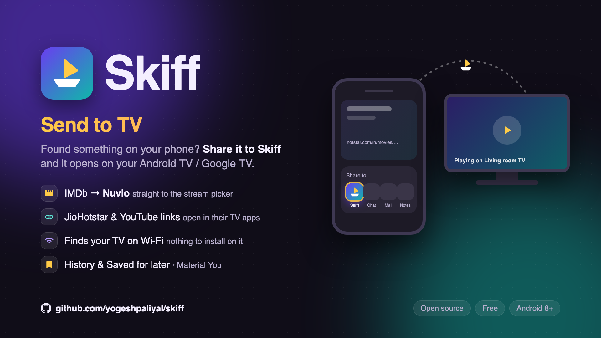

<p align="center"></p>

# Skiff — Send to TV

Send what you found on your phone to your Android TV / Google TV: share a page to Skiff, and it opens on the TV.

- **An IMDb page** (from Chrome or the IMDb app) opens in [Nuvio](https://github.com/NuvioMedia/NuvioTV), on that
  title's stream picker. Movies open right away; for a series, pick the season and episode, then **Play**.
- **Any other link** (JioHotstar, YouTube…) opens in the TV app that opens such links, when the TV has one. How each
  kind of link opens is set by [link rules](RULES.md): a fix there reaches the app without a new release.

Not affiliated with Nuvio or any streaming service.



## History and Saved for later

Every title and link you share, paste or play goes to **History** (newest first, with its episode and when), and the bookmark
saves one **for later**. Tap one to load it, ▶ to play it on the TV; ⋮ edits it (name, movie or series, episode) or
removes it, and so does a swipe, with Undo. Kept on the phone (`files/library.json`).

## How it works

- **Finding the TV.** Google TVs announce themselves on the Wi-Fi (mDNS): `_androidtvremote2._tcp` gives the TV's
  name ("Living room TV"), `_adb._tcp` on port 5555 means network debugging is on. No address to type
  ([TvFinder.kt](app/src/main/java/dev/skiff/TvFinder.kt)).
- **Which Nuvio.** The TV says which apps open `nuvio://` (the Play Store and GitHub builds, forks that kept the
  scheme), plus those opening `stremio://` with Nuvio's activity class `com.nuvio.tv.MainActivity` (forks with their
  own scheme; not Stremio itself). Pick one under **Open with**; titles open in its own activity.
- **The title.** The IMDb id (from the shared link, or typed) gives the name and whether it's a movie or a series,
  through [Cinemeta](https://v3-cinemeta.strem.io), the free catalog Stremio and Nuvio use
  ([Meta.kt](app/src/main/java/dev/skiff/Meta.kt)).
- **Opening it.** Nuvio has no link for a title, but it opens one from these intent extras (the ones it writes to its
  own "Continue Watching" home-screen row). The phone sends them over the TV's ADB, with
  [dadb](https://github.com/mobile-dev-inc/dadb) ([TvLink.kt](app/src/main/java/dev/skiff/TvLink.kt)):

  ```
  am start -n com.nuvio.tv/.MainActivity -f 0x14000000 \
    --es contentId tt42127457 --es contentType series --es videoId tt42127457:1:4 \
    --ei season 1 --ei episode 4 --es launchMode stream --es name 'Agent Kim Reactivated'
  ```

  `launchMode=stream` with a `name` goes to the stream picker; without the name, Nuvio opens the title's page.
  For a movie, `contentType=movie` and `videoId` is just the IMDb id.

- **Other links.** The TV says which apps open the link (`cmd package query-activities`), without the ones that
  open any web page (browsers). The [link rules](RULES.md) can change the link for the TV app first (JioHotstar's
  TV app opens `hotstar://in/movies/…` but not `https://www.hotstar.com/in/movies/…`), order the apps, set how
  the app starts, and say where the title comes from ([Rules.kt](app/src/main/java/dev/skiff/Rules.kt),
  [Links.kt](app/src/main/java/dev/skiff/Links.kt)).

## Setup

1. On the TV: Settings → System → About → press *Android TV OS build* 7 times; then Developer options → turn on
   **USB debugging**.
2. Phone and TV on the same Wi-Fi. Open Skiff: the TV shows up under **Nearby TVs**.
3. The first time you open something, the TV asks **Allow USB debugging?** for the phone: tick *Always allow*.

USB debugging stays on for this to work: anything you allowed on the TV can control it.

## Download

Get the APK from [Releases](../../releases/latest). Up to 1.2.0 the app was *Nuvio Remote* (`dev.nuvioremote`); Skiff
(`dev.skiff`) is a new app for Android, so uninstall the old one. Each tag like `v1.2.0` builds one, signed with the same release
key, so a new version installs over the old one.

## Build

```bash
./gradlew assembleDebug
adb install app/build/outputs/apk/debug/app-debug.apk
```

Kotlin, Jetpack Compose with Material 3 Expressive and Material You colors, minSdk 26.

A release (`assembleRelease`) is signed when `KEYSTORE_FILE`, `KEYSTORE_PASSWORD` and `KEY_ALIAS` are set, as the
[release workflow](.github/workflows/release.yml) does from the repo's secrets; `VERSION_NAME` and `VERSION_CODE`
come from the tag and the run number.
